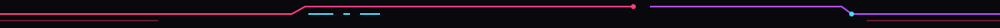
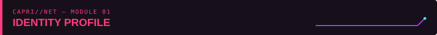
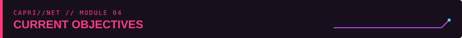

<!--
CAPRI//NET — GitHub Profile README
Antes de publicar:
1. Confira os links de projetos e atualize os que ainda forem espaços reservados.
2. Verifique se os arquivos da pasta assets/ estão no repositório.
3. Revise a lista de tecnologias para refletir seu nível atual.
-->

  
   
  
  <h1>GUILHERME.exe</h1>
  
  
<strong>DESENVOLVIMENTO · DADOS · TECNOLOGIA</strong>

  
Explorando o universo dos dados e construindo soluções que transformam informação em conhecimento.

  <a href="https://github.com/n3arvana">GitHub</a> &nbsp;&middot;&nbsp;
  
  <a href="mailto:guibreno.mjordao@gmail.com">E-mail</a>

  
<code>CAPRI_PROTOCOL :: CONNECTION ESTABLISHED</code>

Olá! Sou Guilherme, formado em Análise e Desenvolvimento de Sistemas e atualmente estudante de Engenharia de Software.

Tenho interesse em tecnologia, desenvolvimento e, principalmente, no universo de Análise de Dados e Business Intelligence. Gosto de explorar como os dados podem revelar padrões, apoiar decisões e gerar soluções para problemas reais.

Atualmente, estou direcionando meus estudos para fortalecer minha base em Python, SQL, Excel e Power BI, enquanto continuo desenvolvendo minha lógica de programação e ampliando minha experiência prática com projetos.

Meu objetivo é evoluir constantemente, transformar aprendizado em projetos e construir uma carreira na interseção entre tecnologia e dados.

- **Status:** em constante aprendizado
- **Foco atual:** Data Analytics · Business Intelligence · Python · SQL
- **Mindset:** aprender, construir, analisar e evoluir

Tecnologias e ferramentas que fazem parte da minha jornada de aprendizado e desenvolvimento.

  
<strong>DATA &amp; ANALYTICS</strong>

  
  
  
<strong>DEVELOPMENT</strong>

  
  
<strong>TOOLS &amp; ENVIRONMENT</strong>

  

Meu nível atual: Python e SQL em nível básico, com familiaridade inicial com bibliotecas como Pandas. Excel e Power BI fazem parte do meu processo de aprofundamento em análise e visualização de dados. Também possuo experiência prática em projetos de páginas web com HTML, CSS e JavaScript.

<h2></h2>

Neste momento, meu foco está em consolidar conhecimentos e transformar teoria em prática.

- [ ] Aprofundar conhecimentos em Python aplicado à análise de dados.
- [ ] Praticar consultas SQL, relacionamentos e manipulação de dados.
- [ ] Evoluir na utilização de Excel e Power BI para construção de indicadores.
- [ ] Desenvolver projetos de portfólio com dados e perguntas de negócio.
- [ ] Aprimorar visualização de dados e comunicação de resultados.

<h2></h2>

  
  
  

